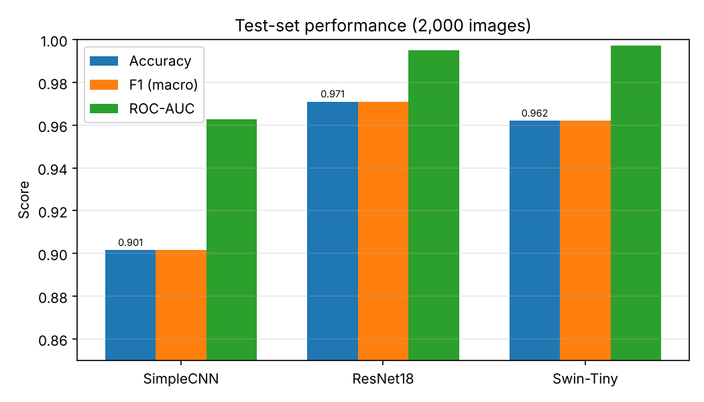
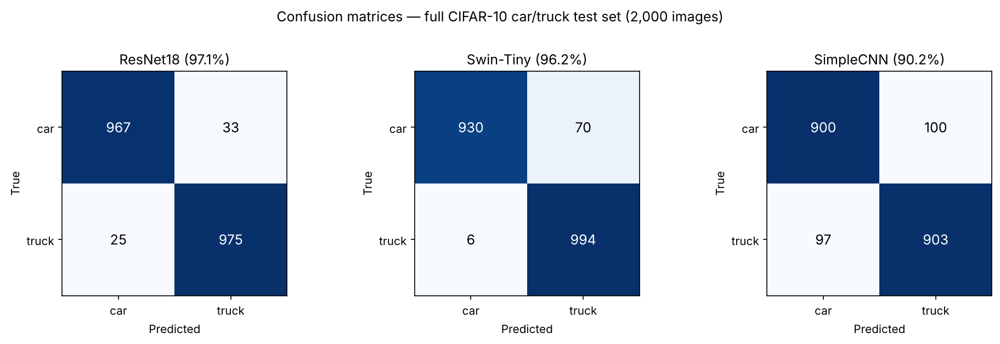
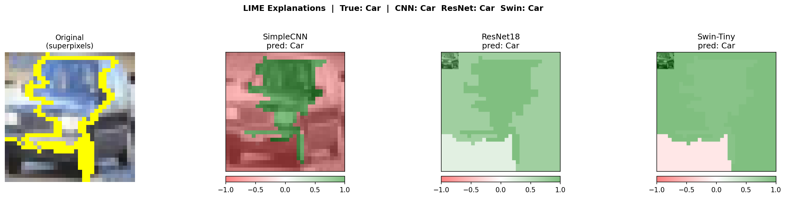

# Car vs. Truck Classification

Deep-learning-based **car vs. truck** image classification on a filtered CIFAR-10
subset, comparing a from-scratch CNN baseline against two transfer-learning models
(ResNet-18 and Swin-Tiny), with **model explainability using LIME**.

> **Team project.** This was a group coursework project for the MSc in Artificial
> Intelligence. See [Team & contributions](#team-and-contributions). All metrics and
> details below come from the project notebook's recorded outputs — nothing is
> estimated or invented.

---

## Overview and motivation

Telling a car from a truck is a compact, well-scoped supervised computer-vision problem:
the label space is small enough for clear analysis, but the two classes are visually
similar enough to make the comparison between model families meaningful. It is also a
realistic stand-in for tasks like traffic analysis and automated tolling.

The project trains and compares three models on the same binary task and then uses
**LIME** to make each model's decisions interpretable — showing which parts of an image
pushed a prediction toward "car" or "truck."

## Problem statement

Classify a 32×32 RGB image as **car (0)** or **truck (1)**. Concretely:

- Compare a simple convolutional baseline (`SimpleCNN`) against two stronger pretrained
  architectures (`ResNet-18`, `Swin-Tiny`) fine-tuned for two classes.
- Evaluate with metrics suitable for a balanced binary task (accuracy, balanced
  accuracy, F1, precision/recall per class, ROC-AUC, PR-AUC).
- Explain predictions with LIME to build intuition about model behaviour.

## Dataset

| Property        | Value                                                                 |
| --------------- | --------------------------------------------------------------------- |
| Source          | CIFAR-10 (Krizhevsky, 2009), public research dataset                  |
| Classes used    | `automobile` (CIFAR class 1) → **car (0)**, `truck` (class 9) → **truck (1)** |
| Train / test    | 10,000 / 2,000 images (filtered to the two classes)                   |
| Image size      | 32×32 RGB; pretrained models resize to 224×224 + ImageNet-normalize   |
| Download        | automatic via `torchvision` on first run                              |

The full dataset is **not committed**; see [`data/README.md`](data/README.md). Two small
convenience subsets (`train_sample.pt`, `test_sample.pt`) allow quick runs — but note
they are *not* the evaluation set (see the reproducibility note below).

## Models and training pipeline

Three models, all evaluated on the same held-out test set:

| Model       | Type                                   | Input    | Epochs | LR    |
| ----------- | -------------------------------------- | -------- | :----: | ----- |
| SimpleCNN   | from-scratch CNN baseline              | 32×32    | 10     | 1e-3  |
| ResNet-18   | ImageNet-pretrained, fine-tuned (fc→2) | 224×224  | 5      | 1e-4  |
| Swin-Tiny   | ImageNet-pretrained, fine-tuned (head→2)| 224×224 | 5      | 1e-4  |

Common settings: batch size 64, Adam optimizer, cross-entropy loss, 80/20 train/val
split (seed 42), CUDA when available. The best weights per model are saved to `models/`.

## Data preprocessing and augmentation

- Images are loaded as `(3, 32, 32)` float tensors scaled to `[0, 1]`.
- **SimpleCNN** consumes the 32×32 tensors directly (CIFAR-10 is already clean and
  labelled, so little preprocessing is needed).
- **ResNet-18 / Swin-Tiny** additionally resize to 224×224 and apply ImageNet mean/std
  normalization to match their pretrained feature space.

The notebook includes a sample-batch inspection step to visually sanity-check the
pipeline before training.

## Results

Evaluated on the **full 2,000-image car/truck test set** (from the main notebook):

| Model      | Accuracy | Balanced acc. | F1 (macro) | ROC-AUC | PR-AUC |
| ---------- | :------: | :-----------: | :--------: | :-----: | :----: |
| ResNet-18  | **0.9710** | 0.9710      | 0.9710     | 0.9952  | 0.9947 |
| Swin-Tiny  | 0.9620   | 0.9620        | 0.9620     | 0.9971  | 0.9973 |
| SimpleCNN  | 0.9015   | 0.9015        | 0.9015     | 0.9628  | 0.9588 |

Per-class highlights: ResNet-18 is the most balanced (precision/recall ≈ 0.97 on both
classes); Swin-Tiny has the highest ROC/PR-AUC but is slightly skewed (recall 0.930 on
car vs. 0.994 on truck); the from-scratch SimpleCNN is a solid ~90% baseline.

Final validation accuracies during training were 0.971 (ResNet-18), 0.966 (Swin-Tiny),
and 0.9105 (SimpleCNN).

| Model comparison | Confusion matrices |
| --- | --- |
|  |  |

> The comparison and confusion-matrix figures above are regenerated from the notebook's
> recorded test metrics so they are reproducible; the LIME figure below is the original
> notebook output.

> **Reproducibility note (please read).** The project contains two near-identical
> notebooks. The main `car_truck_modeling.ipynb` was run on the **full** 2,000-image
> test set and produced the numbers above. A second, duplicate notebook ("Copy of …")
> was run on the tiny 200-image `test_sample.pt` subset and therefore reported
> near-perfect scores (ResNet-18 and Swin-Tiny at 1.00, SimpleCNN 0.98) — those are an
> artifact of the small subset, **not** representative performance. This repository ships
> the main notebook. If you run it with the sample `.pt` files present, you will see the
> small-subset behaviour; remove them to reproduce the full-test-set results.

## Explainability — LIME

Nima's contribution to the project. LIME is implemented with **Captum's `Lime`**
(`captum.attr.Lime`) and **SLIC superpixels** from scikit-image:

- Each test image is segmented into superpixels (SLIC, `n_segments = 10`).
- LIME perturbs those superpixels (`n_samples = 500`), measures the effect on the
  model's output, and fits a local linear surrogate to attribute importance to each
  region.
- Attributions are visualised over the original image for all three models side by side,
  so you can compare *where* each model "looks" when deciding car vs. truck.

Example output for test image #55:



## Repository structure

```
car-truck-classification/
├── car_truck_modeling.ipynb     # the main notebook (data → models → eval → LIME)
├── README.md                    # this file
├── requirements.txt
├── .gitignore
├── data/
│   ├── README.md                # dataset access + the sample .pt files
│   └── test_sample.pt           # 200-image convenience subset (train_sample.pt: see data/README)
├── models/
│   ├── README.md                # checkpoint details + how to load/regenerate
│   └── simple_cnn_car_truck.pth # baseline weights (resnet18/swin: see models/README)
└── assets/
    ├── lime_idx_55.png          # original LIME visualization from the notebook
    ├── model_comparison.png     # regenerated from recorded metrics
    └── confusion_matrices.png   # regenerated from recorded metrics
```

**Not committed:** full CIFAR-10 (downloaded on demand), the Swin-Tiny checkpoint
(~110 MB, over GitHub's limit), and — depending on how the repo was populated — the
ResNet-18 checkpoint and `train_sample.pt` (both over the 10 MB transfer limit of the
tool that built the repo). All are easy to regenerate or add; see the folder READMEs.

## Technologies

Python · PyTorch · torchvision · Captum (LIME) · scikit-image (SLIC) · scikit-learn ·
pandas · NumPy · matplotlib · seaborn. Versions pinned in
[`requirements.txt`](requirements.txt); the recorded run used PyTorch 2.10, torchvision
0.25, Captum 0.9, on a CUDA 12 GPU.

## Installation and environment setup

```bash
git clone https://github.com/NimaAhmadi79/car-truck-classification.git
cd car-truck-classification
python -m venv .venv && source .venv/bin/activate   # optional
pip install -r requirements.txt
```

A GPU is recommended (Swin-Tiny fine-tuning is slow on CPU) but the notebook falls back
to CPU automatically.

## Running the notebook

### On Google Colab

1. Open `car_truck_modeling.ipynb` in Colab (*File → Open notebook → GitHub*).
2. Set a GPU runtime: *Runtime → Change runtime type → T4 GPU*.
3. Run the **Environment setup** cell — it detects Colab, mounts Drive, and sets
   `PROJECT_DIR`/`MODELS_DIR`/`DATA_DIR`.
4. Run all cells. CIFAR-10 downloads automatically if the sample `.pt` files are absent.

### Locally

1. Install dependencies (above).
2. Launch Jupyter and run top to bottom:
   ```bash
   jupyter notebook car_truck_modeling.ipynb
   ```
   The Environment setup cell detects you are not on Colab and uses `./data` and
   `./models` (override the base with `CAR_TRUCK_PROJECT_DIR`).

### Inference with a saved checkpoint

See [`models/README.md`](models/README.md) for a copy-paste example of loading a
checkpoint and running a prediction (label mapping: `0 = car`, `1 = truck`).

## Limitations and possible improvements

- **Near-ceiling on an easy task.** 32×32 car/truck is relatively easy for pretrained
  models; harder or out-of-distribution images would better probe generalization.
- **Short fine-tuning.** ResNet-18/Swin-Tiny train for only 5 epochs; longer schedules
  or learning-rate tuning might shift the ranking.
- **Single run.** Results are from one seed/split; repeated runs or cross-validation
  would quantify variance.
- **Two-notebook seam.** The duplicate notebook evaluated on a tiny subset; consolidating
  to a single notebook run end-to-end on the full set would remove the ambiguity (this
  repo keeps the full-set notebook and documents the issue).
- **Large artifacts.** Swin-Tiny weights don't fit on plain GitHub; Git LFS or an
  external release would be needed to ship them.

## Team and contributions

A four-person MSc coursework project:

| Member                        | Role                                   |
| ----------------------------- | -------------------------------------- |
| Artur Schneider               | Data preprocessing, project management |
| Amirmasoud Ahmadi Kolsaraki   | Model design, training / fine-tuning   |
| **Seyed Nima Ahmadi**         | **Explainable AI — LIME**              |
| Gustav Axelsson               | Evaluation, results                    |

As recorded in the notebook's AI-usage declaration, generative-AI tools (Microsoft
Copilot and Claude) were used for brainstorming, code assistance, and refining write-ups,
with outputs verified against actual results and course material.

## License

No license is currently applied. Because this is shared team work, the code is jointly
owned by the four authors above; a license should only be added with the whole team's
agreement. Until then, default copyright applies (all rights reserved). CIFAR-10 remains
under its own original terms (see [`data/README.md`](data/README.md)).
